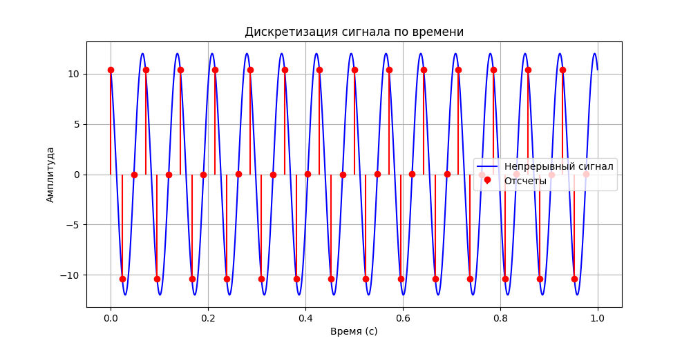
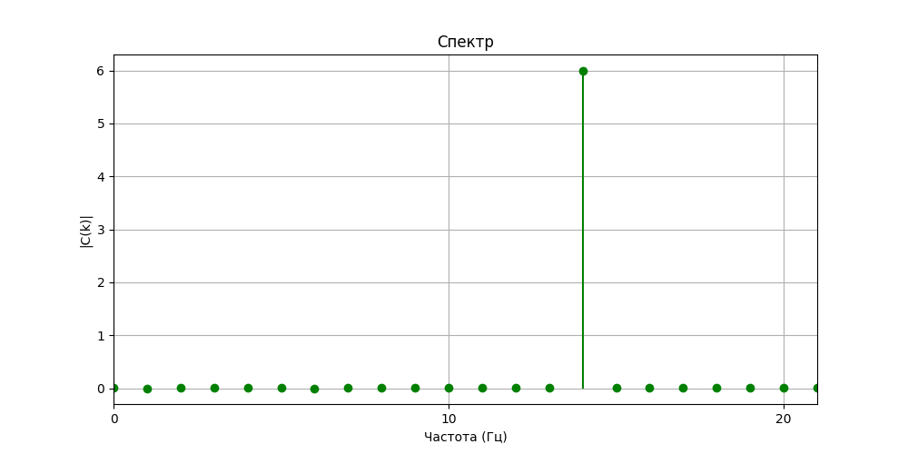
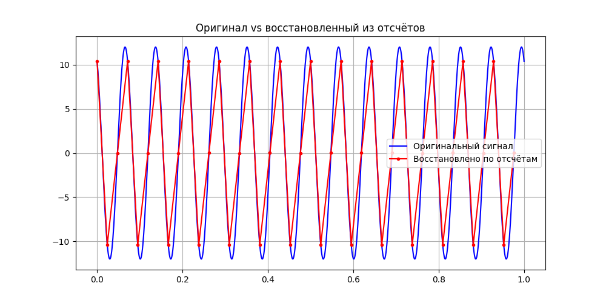
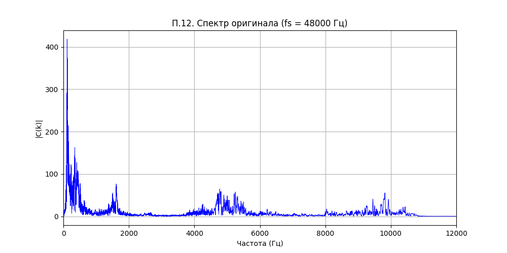
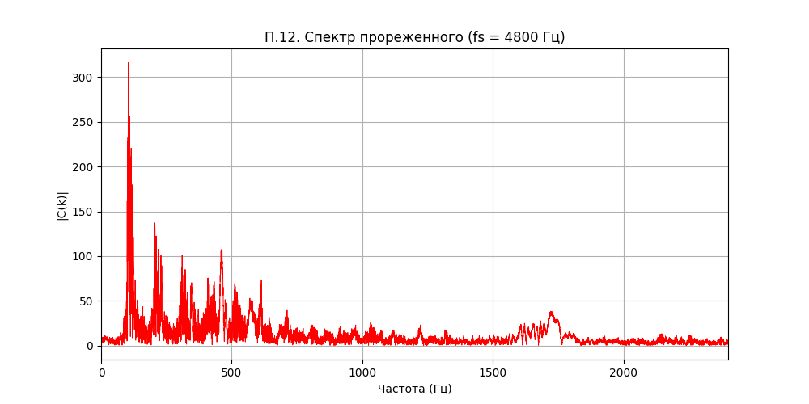
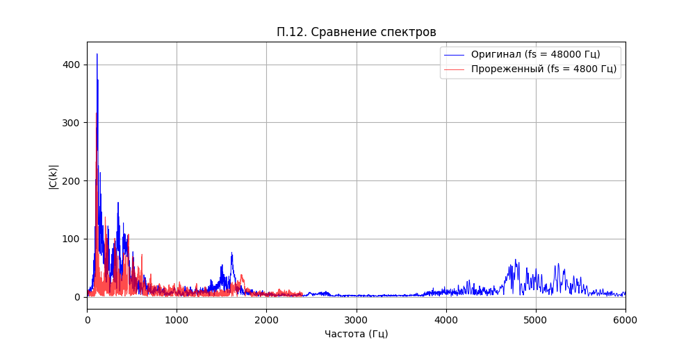
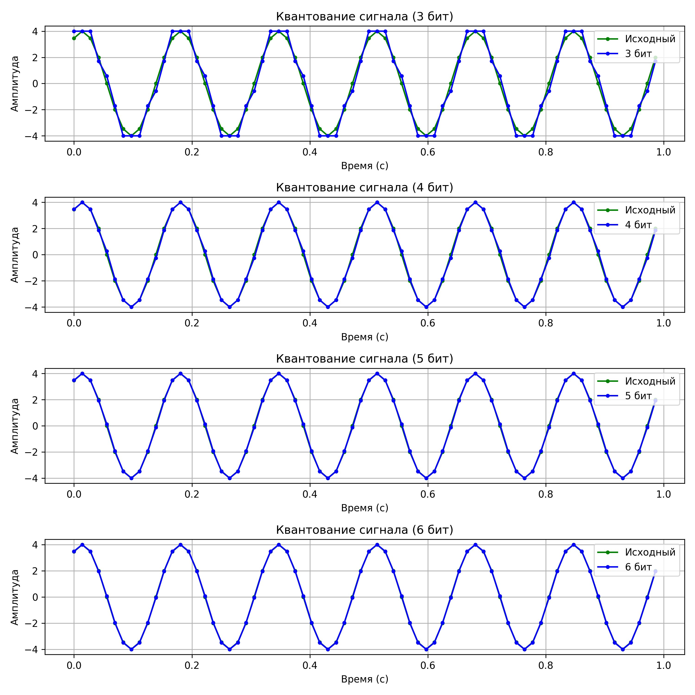
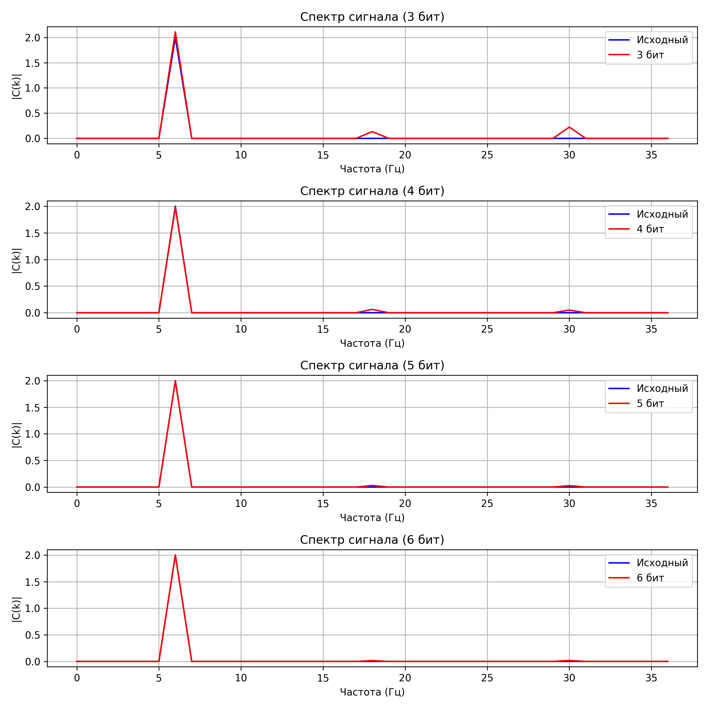
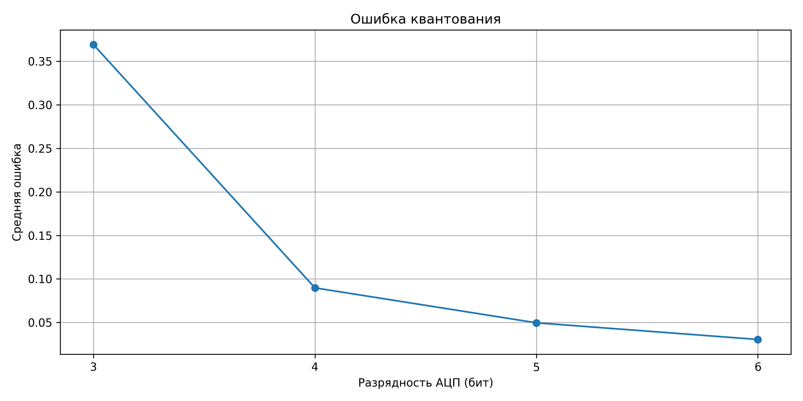

# ОСМС — Занятие №1
## Временная и частотная формы сигналов. Преобразования Фурье. Дискретизация сигналов

**Дисциплина:** Основы систем мобильной связи 
**Автор:** Садилов Даниил Сергеевич  
**Группа:** ИКС-431  
**Вариант:** 17  

---

## Цель работы

Изучить влияние частоты дискретизации и разрядности АЦП на частотные характеристики сигнала, освоить прямое и обратное преобразования Фурье, а также переходы между временным и частотным представлениями сигналов.

---

## Основные формулы

### 1. Исходный сигнал (Вариант 17)

$$y(t) = A \cdot \cos(2\pi f t + \varphi_0) = 12 \cdot \cos\left(2\pi \cdot 14 \cdot t + \frac{\pi}{6}\right)$$

где:
- $A = 12$ — амплитуда сигнала
- $f = 14$ Гц — частота сигнала
- $\varphi_0 = \pi/6$ — начальная фаза

### 2. Теорема Котельникова (Найквиста)

$$f_s \geq 2 \cdot f_{\max}$$

Минимальная частота дискретизации для корректного восстановления сигнала должна быть не менее чем в 2 раза больше максимальной частоты в спектре сигнала.

### 3. Дискретные отсчёты непрерывного сигнала

$$x[n] = x(t)\big|_{t=nT} = x(nT), \quad T = \frac{1}{f_s}$$

### 4. Прямое дискретное преобразование Фурье (ДПФ)

$$F(k) = \sum_{n=0}^{N-1} x[n] \cdot e^{-j\frac{2\pi}{N}kn} = \sum_{n=0}^{N-1} x[n]\left(\cos\frac{2\pi kn}{N} - j\sin\frac{2\pi kn}{N}\right)$$

где:
- $x[n]$ — отсчёт сигнала во временной области
- $F(k)$ — спектральная компонента на частоте $k$
- $N$ — количество отсчётов

Разделение на действительную и мнимую части:

$$\text{Re}[F(k)] = \sum_{n=0}^{N-1} x[n] \cdot \cos\left(\frac{2\pi kn}{N}\right)$$

$$\text{Im}[F(k)] = -\sum_{n=0}^{N-1} x[n] \cdot \sin\left(\frac{2\pi kn}{N}\right)$$

### 5. Амплитудный спектр

$$|C(k)| = \frac{|F(k)|}{N} = \frac{\sqrt{\text{Re}^2 + \text{Im}^2}}{N}$$

### 6. Частотная сетка

$$f_k = k \cdot \frac{f_s}{N}, \quad k = 0, 1, \ldots, N-1$$

### 7. Быстрое преобразование Фурье (алгоритм Кули-Тьюки)

Рекурсивное разделение на чётные и нечётные отсчёты:

$$X(k) = E(k) + W_N^k \cdot O(k)$$

$$X(k + N/2) = E(k) - W_N^k \cdot O(k)$$

где $W_N^k = e^{-j\frac{2\pi k}{N}}$ — твиффл-фактор, $E(k)$ и $O(k)$ — БПФ чётных и нечётных отсчётов соответственно.

Сложность алгоритма: $O(N \log_2 N)$ вместо $O(N^2)$ для прямого ДПФ.

### 8. Прореживание сигнала (downsampling)

$$y_1[n] = y[10n], \quad f_{s1} = \frac{f_s}{10}$$

### 9. Квантование сигнала (Вариант 3)

Исходный сигнал: $y(t) = 4 \cdot \sin\left(2\pi \cdot 6 \cdot t + \frac{\pi}{3}\right)$, $f_s = 12f = 72$ Гц

Формула квантования с разрядностью $b$ бит:

$$q = \text{round}\left(\frac{y - y_{\min}}{y_{\max} - y_{\min}} \cdot (2^b - 1)\right)$$

$$y_q = \frac{q}{2^b - 1} \cdot (y_{\max} - y_{\min}) + y_{\min}$$

Количество уровней квантования: $L = 2^b$

### 10. Средняя ошибка квантования

$$\varepsilon = \frac{1}{N}\sum_{n=0}^{N-1} |y[n] - y_q[n]|$$

### 11. Объём памяти для хранения отсчётов

$$V = N \cdot 8 \text{ байт} \quad (\text{для типа float64})$$

---

## Результаты выполнения

### Пункты 1-7: Дискретизация периодического сигнала (sms1.py)

**Исходные данные (Вариант 17):**

$$y(t) = 12 \cdot \cos\left(2\pi \cdot 14 \cdot t + \frac{\pi}{6}\right), \quad f = 14 \text{ Гц}$$

- Максимальная частота в спектре: $f_{\max} = 14$ Гц
- Минимальная частота дискретизации: $f_s \geq 2f_{\max} = 28$ Гц
- Выбранная частота: $f_s = 3f = 42$ Гц
- Количество отсчётов: $N = f_s = 42$
- Объём памяти: $V = N \cdot 8 = 336$ байт

**Графики:**

Дискретизация сигнала по времени:

Амплитудный спектр (ограничен до $f_s/2$):

Оригинал vs восстановленный сигнал:

---

### Пункты 8-12: Анализ голосового сигнала (sms1.2.py)

**Выполнено:**
- Считан аудиофайл `voice.wav`, определена реальная частота дискретизации $f_s$
- Построен амплитудный спектр оригинального сигнала
- Выполнено прореживание: $y_1[n] = y[10n]$, $f_{s1} = f_s / 10$
- Продемонстрирован эффект наложения спектров (алиасинг) при заниженной $f_s$

**Графики:**

Спектр оригинального сигнала:

Спектр прореженного сигнала:

Сравнение спектров:

---

### Пункт 13: Влияние разрядности АЦП (sms1.3.py)

**Исходные данные (Вариант 3):**

$$y(t) = 4 \cdot \sin\left(2\pi \cdot 6 \cdot t + \frac{\pi}{3}\right), \quad f = 6 \text{ Гц}, \quad f_s = 12f = 72 \text{ Гц}$$

**Исследована разрядность АЦП:** $b \in \{3, 4, 5, 6\}$ бит

Количество уровней квантования: $L = 2^b \in \{8, 16, 32, 64\}$

**Графики:**

Квантование сигнала при разной разрядности:

Спектры при разной разрядности АЦП:

Зависимость ошибки квантования от разрядности:

